# GeoSampler walkthrough: one field, start to finish

This page follows one example field through the live app, one step at a time, with a screenshot for each step. You can repeat it yourself with the two files in [`example_data/`](example_data/).

- **App:** <https://recuga.shinyapps.io/geosampler/> (version 2.0.62)
- **Field:** a 33 ha (82 ac) field at the UGA Iron Horse Plant Sciences Farm, Greene County, Georgia. A public research farm, not a grower's field.
- **Captured:** 17 November 2026, at 1440 × 900 in a desktop browser.

> **About the example data.** The field outline ([`iron_horse_example_field.geojson`](example_data/iron_horse_example_field.geojson)) was drawn by hand from public aerial imagery for this walkthrough. It is not a surveyed boundary. The "prior" points ([`example_prior_grid_points.geojson`](example_data/example_prior_grid_points.geojson)) are a made-up 1 ha grid (32 points, 100 m spacing). They hold locations only, with no lab values. Use them to see how the comparison tabs work, not as real field history.

## The workflow at a glance

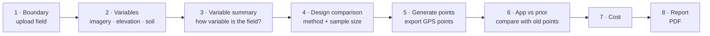

| Step | Tab | What you do | Output |
|---|---|---|---|
| 0 | Dashboard | Read the workflow map | — |
| 1 | Boundary | Upload or draw one field | Field outline and area |
| 2 | Variables | Get Sentinel-2 imagery, a DEM and terrain layers, plus soil if you want it | Covariate layers clipped to the field |
| 3 | Variables → Variable summary | Compute the summary | High / Moderate / Low variability for each layer |
| 4 | Sampling → Design comparison | Pick Auto mode and run the comparison | Recommended method and sample size |
| 5 | Sampling → Generate sample points | Generate the recommended points | Points you can download (GeoJSON, CSV, ZIP) |
| 6 | App vs prior | Upload earlier sample points | Map, table, distributions, nutrient check |
| 7 | Cost | Enter your rates | Cost of the GeoSampler plan vs. your prior plan |
| 8 | Report | Download the report | PDF of the finished steps |

---

## Step 0 — Dashboard

The opening tab. The workflow map shows every step, and clicking a box opens that tab. The app works on **one field at a time**: finish a field, then clear or replace the boundary before moving to the next.

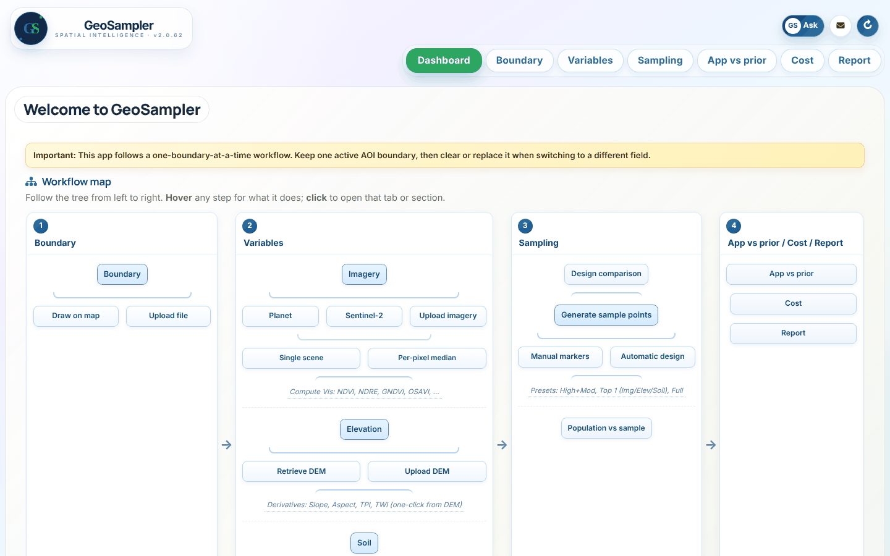

---

## Step 1 — Boundary

1. Open **Boundary**.
2. Under *Select Boundary Method*, choose **I have my own boundary layer**. To draw the field instead, choose *I want to digitize* and use the polygon or rectangle tool on the map.
3. Click **Browse…** and pick `iron_horse_example_field.geojson`. The app accepts GeoJSON, KML/KMZ, zipped shapefiles, GeoPackage, or a `.shp` with its sidecar files.

The field appears on the map with its area (33.1 ha · 81.8 ac). The **Good size** label means the app can handle a field this size comfortably. *Field context (optional)* records the sampling timing and crop for the report.

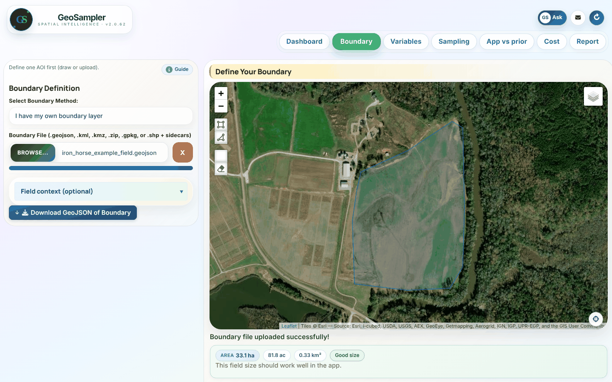

Click **Next: Variables & derivatives**.

---

## Step 2 — Variables (the covariate layers)

Every layer you load here is cropped to the field. These are the layers the sampling designs try to represent.

### 2a · Sentinel-2 imagery

1. **Imagery** sub-tab → *Retrieve Sentinel-2 Imagery (Free, No Key Required)*.
2. Keep **Single scene**. Use *Median composite* if you want several dates blended into one image.
3. Set a date range and a maximum cloud cover. The default is the last month and 30%. Click **Search**.
4. Pick a scene from the list (*oldest to newest*, with cloud %). Then click **Retrieve Selected**.

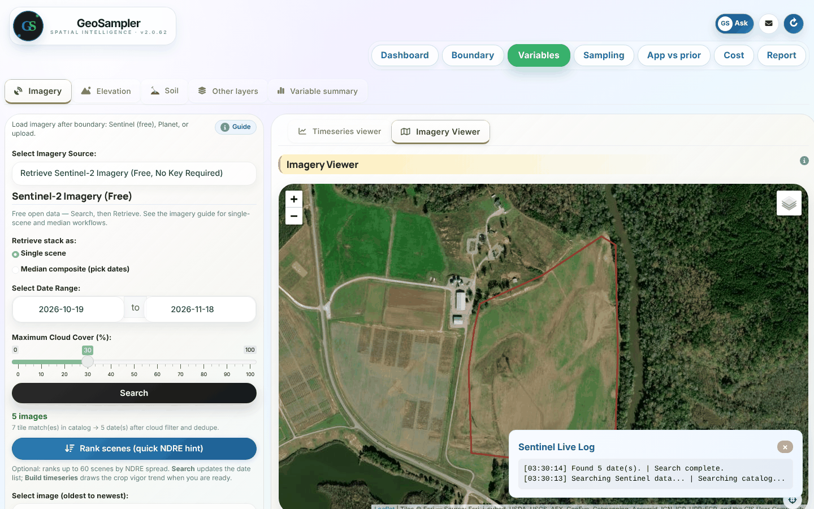

5. Click **Calculate VIs** to add NDVI, NDRE, GNDVI, OSAVI, CIre and VARI. Choose any band or index under *Select to Display* to view it. NDRE is shown below.

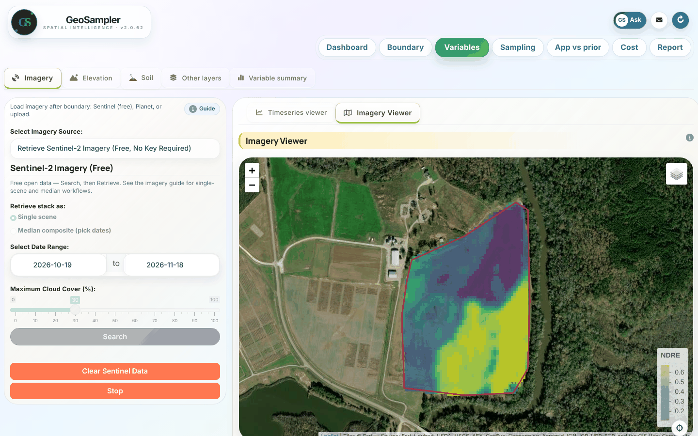

### 2b · Elevation and terrain derivatives

1. **Elevation** sub-tab → **Retrieve Elevation Data**. The DEM comes from AWS Terrain Tiles via `elevatr`; for this field the cells are about 9.6 m. You can also upload your own DEM.
2. **Calculate derivatives** adds Slope, Aspect, TPI and TWI in one step.

| DEM | Topographic Wetness Index |
|---|---|
| 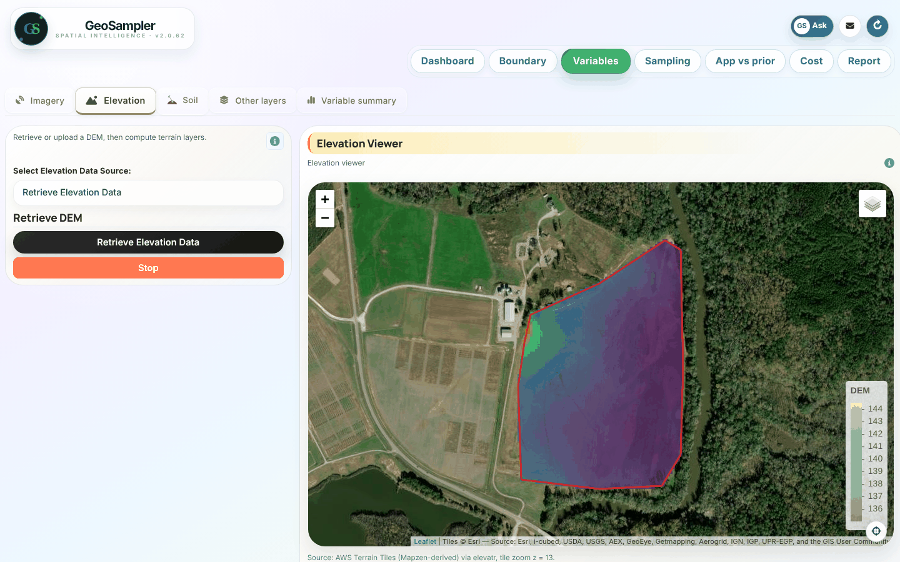 | 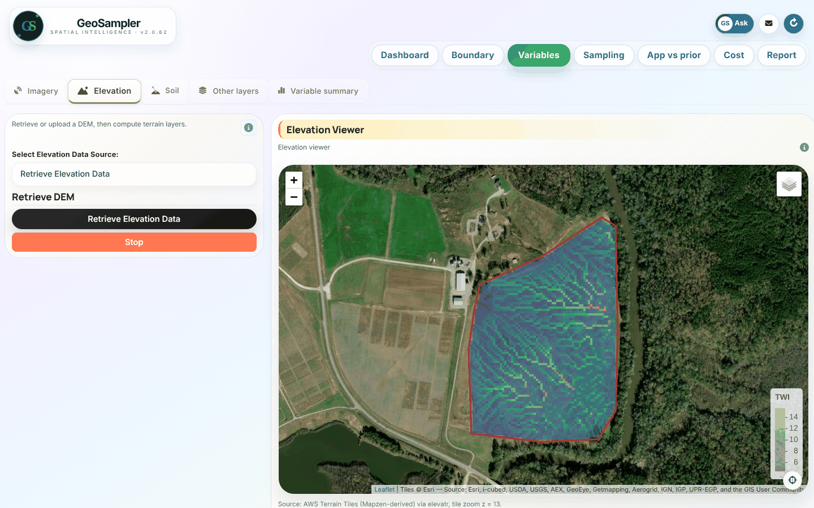 |

### 2c · Soil (optional)

**Soil** sub-tab → *Retrieve USDA SSURGO Soil Data*. Choose a depth range, such as 0–30 cm for the plow layer, and the properties you want (clay, sand, silt, OM, AWC, pH, bulk density, CEC, …). Then click **Retrieve SSURGO Soil Data**. You can also upload your own soil rasters.

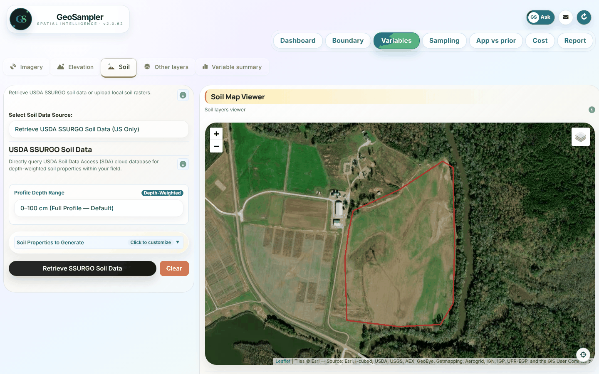

> The USDA Soil Data Access service was down when these screenshots were taken. It was returning HTTP 502 from USDA's side. So this example runs without soil layers. Everything else works the same way with or without them.

### 2d · Other layers (optional)

**Other layers** takes any extra GeoTIFF, such as yield, EC or a drone index. This example doesn't use it.

---

## Step 3 — Variable summary

**Variables → Variable summary → Compute / refresh summary.**

This step ranks every loaded layer by how much it varies inside the field: **High**, **Moderate** or **Low**. Each layer gets a card with its CV, range, mean and median. The ranking sets the default covariate preset in the next step. (If you open *Sampling* first, the app asks you to compute this summary.)

In this field, 8 layers were High, 2 Moderate and 1 Low.

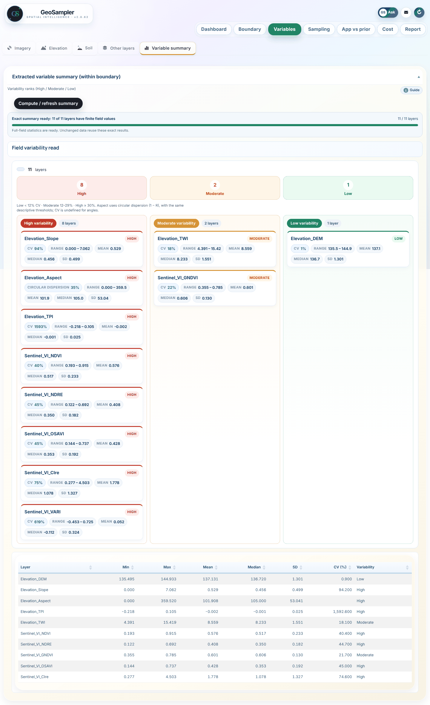

---

## Step 4 — Design comparison (method + sample size)

### 4a · Choose the strategy

When you first open **Sampling**, the app asks how to pick the sample size:

- **Option 1 — Auto GeoSampler Recommendation** (recommended). The app tests all 5 methods at growing sample sizes and stops when more samples stop raising the score.
- **Option 2 — Custom Budget Comparison.** You set the sample size or sizes, and the app finds the best method at those sizes.

This example uses Option 1. Click **Confirm & Continue**. You can switch later with **Change Mode**.

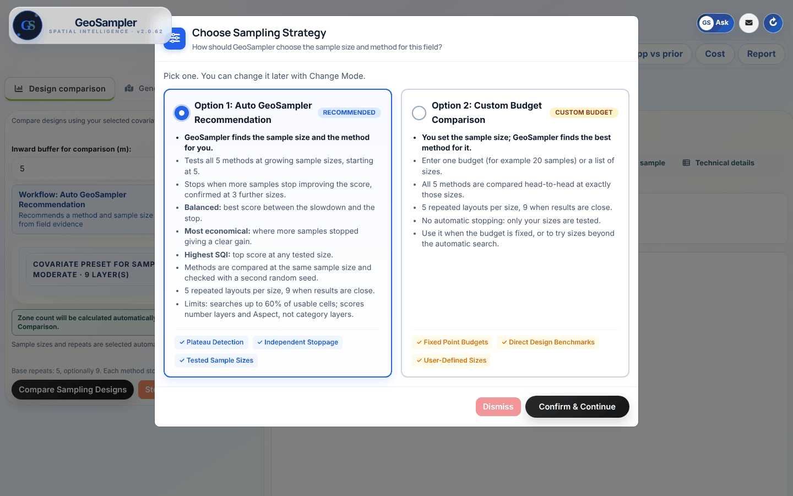

### 4b · Run the comparison

The left panel shows:

- the **inward buffer**, 5 m by default, which keeps points off the field edge
- the **covariate preset**: High + Moderate layers, 9 here. Expand it to change which layers are used.
- the zone count, which is set automatically.

Click **Compare Sampling Designs**. A progress card tracks each method, size and repeat. The full comparison took about 1.5 minutes for this field on the hosted app.

| Before | Running |
|---|---|
| 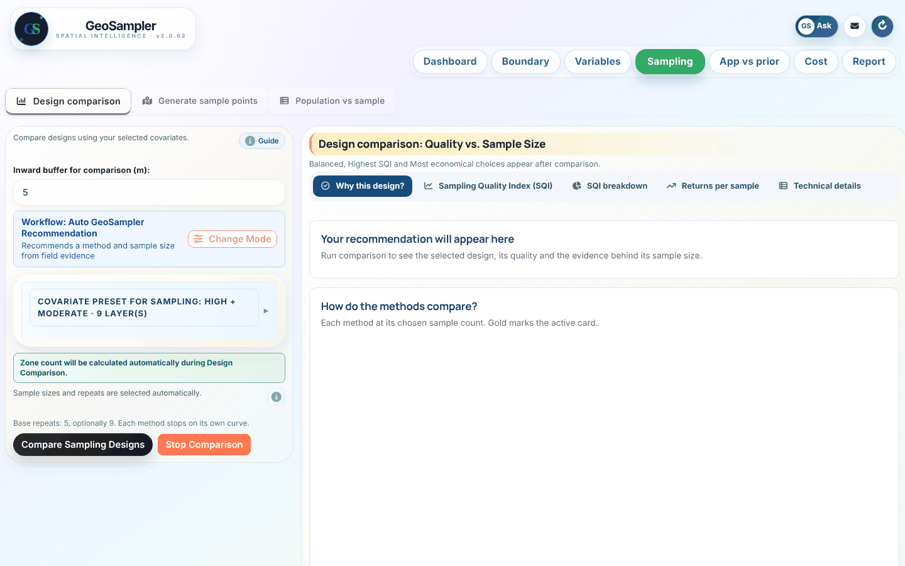 | 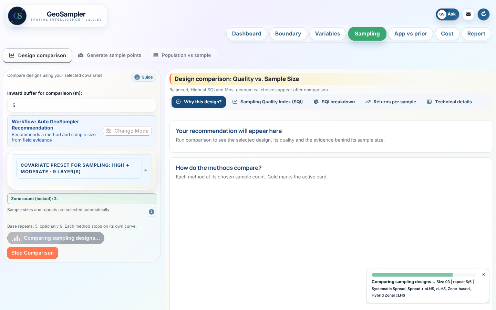 |

### 4c · Read the recommendation

The result gives three choices:

- **Balanced** (gold, selected by default)
- **Highest SQI**
- **Most economical**

For this field:

| Choice | Method | Samples | Median SQI |
|---|---|---|---|
| **Balanced (active)** | Spread + cLHS | **101** | **87.8%** |
| Highest SQI | cLHS | 131 | 88.6% |
| Most economical | Systematic Spread | 93 | 86.7% |

The **Why this design?** panel splits the score into three parts:

- distribution agreement (95.7%)
- joint coverage of combined conditions (87.9%)
- rare-tail representation (80.3%)

It also confirms the curve reached a plateau. **How do the methods compare?** plots every method's repeat scores, and fresh repeats with new random seeds confirm the choice. Use **Use this design** on another card to switch.

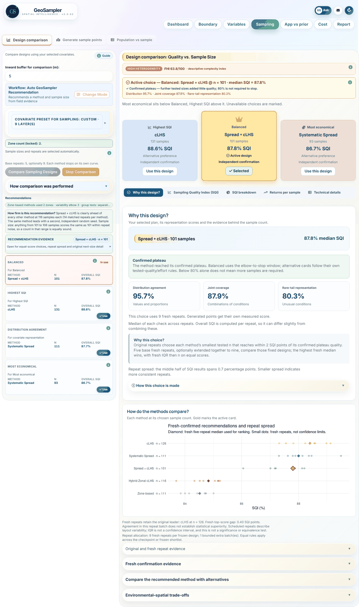

Two other tabs show how the sample size was found:

| SQI vs sample size | Returns per extra sample |
|---|---|
| 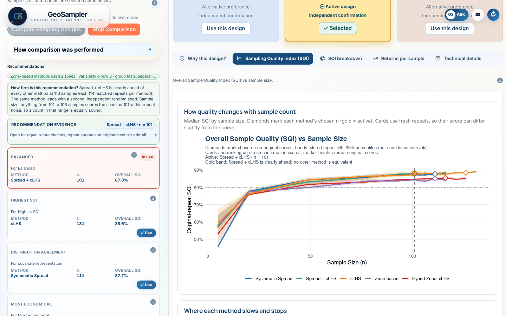 | 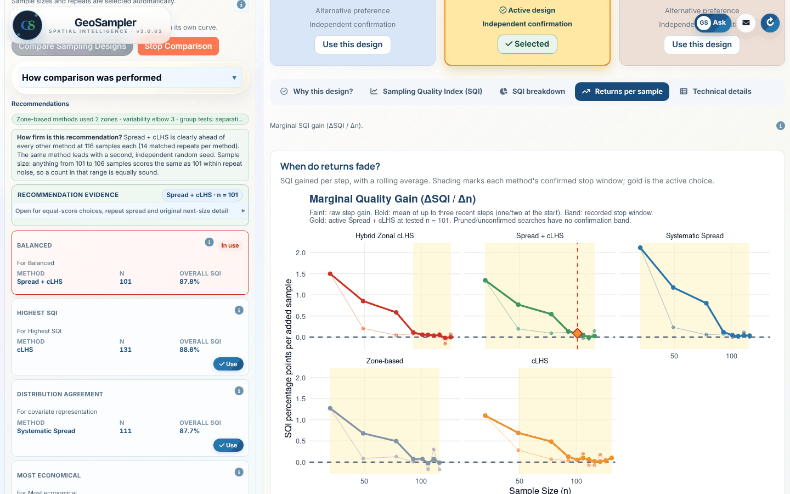 |

- **Sampling Quality Index (SQI)**: score vs. sample size for each method. Diamonds mark each method's chosen n.
- **Returns per sample**: how much each extra sample adds. The shaded band is where gains flatten out.
- **SQI breakdown** and **Technical details** give the full numbers.

---

## Step 5 — Generate sample points

**Sampling → Generate sample points.**

1. The panel already holds the recommendation (*Spread + cLHS · n = 101*). That works out to 3.16 points/ha (1.28/ac).
2. Click **Generate recommended pts**. The layout is reproducible: the same inputs give the same points.
3. Optional: **Improve layout** runs an extra refinement pass on the layout. **Edit points** lets you drag, add or delete markers before you save.
4. Choose a layer under *Select Layer to View* to check the points against it (NDRE below).
5. Download as **GeoJSON**, **CSV**, **Metadata JSON**, an **R script**, or the **Full Bundle (ZIP)**.

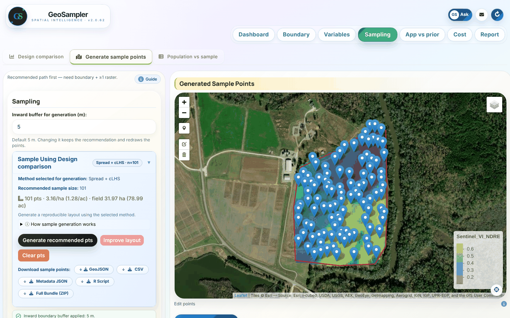

**Population vs sample** compares the sample with the whole field, layer by layer. Every layer here passed as *Close*.

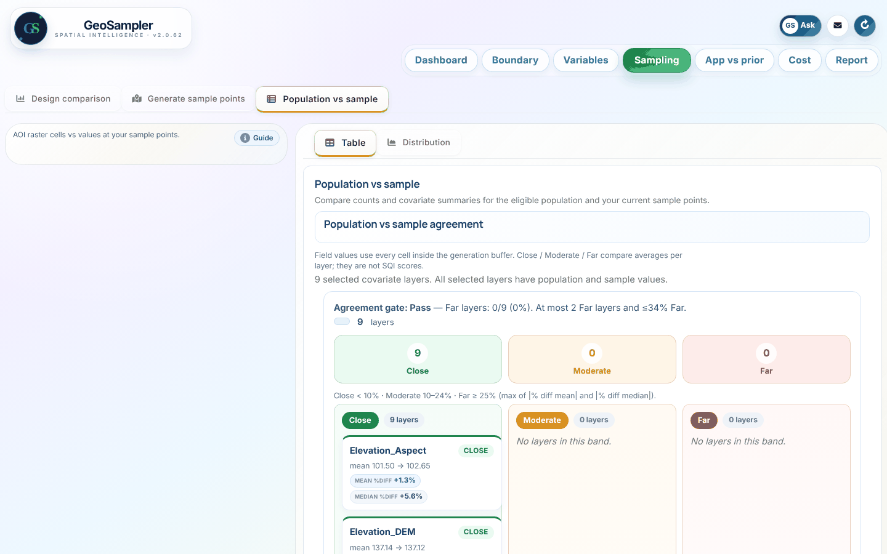

---

## Step 6 — App vs prior

If the field was sampled before, upload those points under **App vs prior → Historical points**. Here that's `example_prior_grid_points.geojson`, the made-up 1 ha grid. The app reads each loaded layer at every point and compares the two designs.

- **Map**: app points (blue) and prior points (orange).

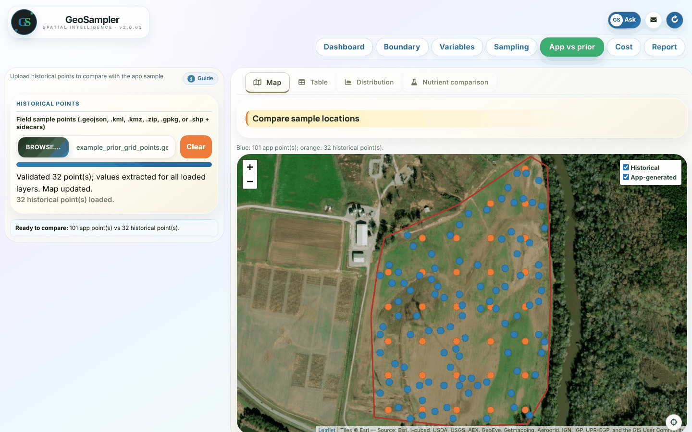

- **Table**: puts each layer in a band (*Close* < 10%, *Moderate* 10–24%, *Far* ≥ 25% difference in mean or median) and gives an overall agreement result.
- **Distribution**: click *Compute distributions* for violin plots by layer.

| Table | Distribution |
|---|---|
| 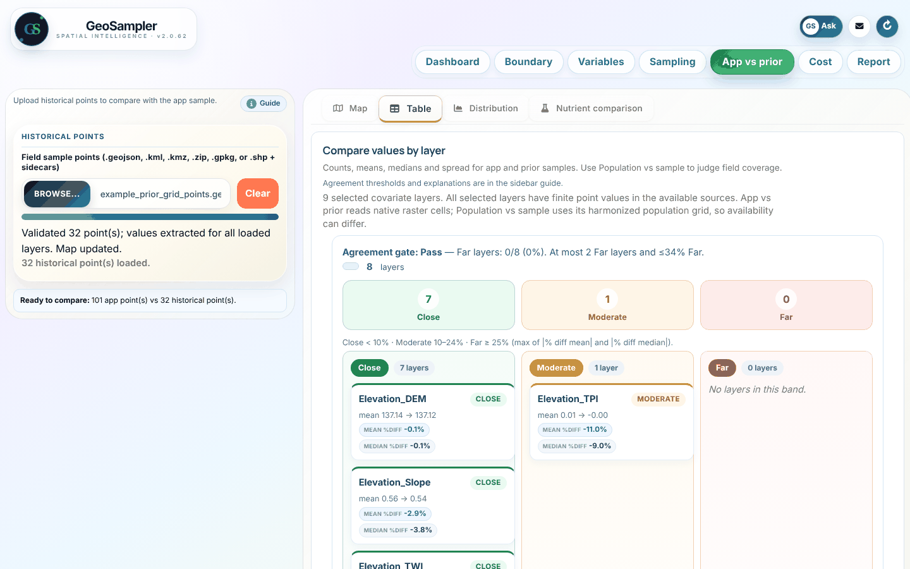 | 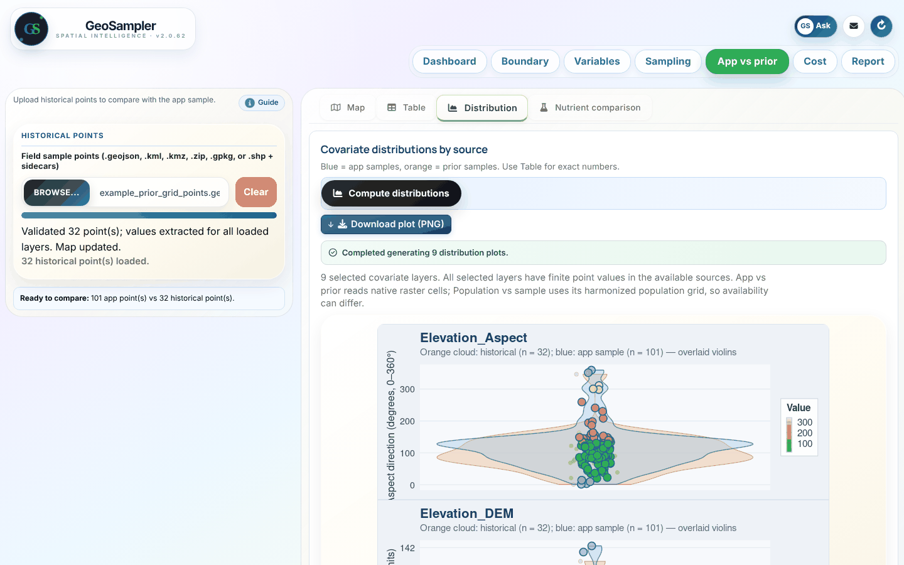 |

- **Nutrient comparison**: if your prior points carry soil-test columns (P, K, pH, …), each app point takes the value of its nearest prior point. Both sets are then kriged and the two maps compared. An optional *Tame outliers* setting stops one extreme point from driving the map. The example grid has no lab values, so only the spacing summary is shown: app points sit 38 m from a prior point on average, and 31 of the 32 prior points are used.

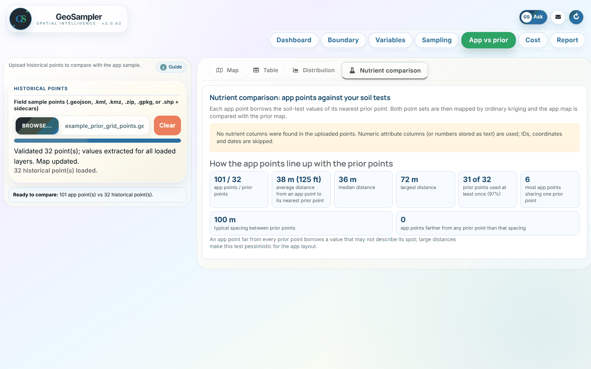

---

## Step 7 — Cost

**Cost** fills in both sample counts for you: 101 app points and 32 prior points. You add:

- laboratory cost per sample
- travel speed between points
- minutes spent at each sample
- labour cost per hour
- currency

The bar chart shows total cost, split into laboratory and field labour. With the default rates ($25 per sample, 3 mph, 5 minutes per sample, $25 per hour), the 101-point plan costs about $2,760 against $883 for the 32-point grid. The extra cost buys the coverage shown in Steps 4–6.

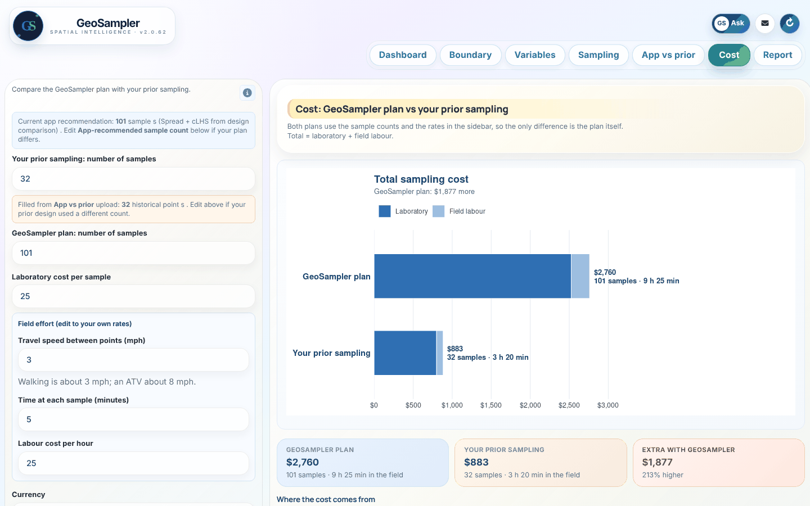

---

## Step 8 — Report

**Report** lists every finished step: inputs, decision evidence and the final layout. **Download PDF report** builds a PDF with only those sections. Skipped steps are left out, so there are no empty placeholders.

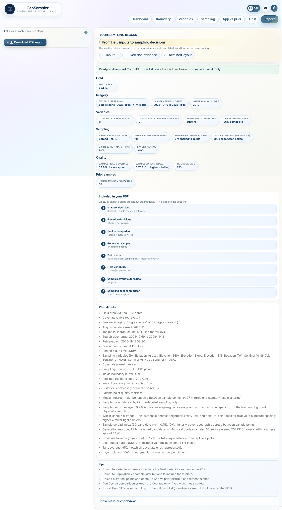

---

## Tips

- **Save your work.** Saving the project writes a `.geosampler` file with the inputs, the analysis grid and the results. Loading it, locally or in the hosted app, reproduces the same recommendation.
- **One field at a time.** Clear the boundary, or use the reset button at the top right, before you start a new field.
- **Ask.** The **GS Ask** button answers questions about the app and its methods.
